# E-Commerce Sales & Customer Insights Dashboard

## Project Overview

This project focuses on analysing e-commerce sales and customer data to identify business trends, evaluate sales performance, understand customer behaviour, and generate actionable business insights.

The project follows an end-to-end data analytics workflow using Python, SQL, and Power BI. The dataset is used to support sales analysis, product performance analysis, regional comparisons, customer segmentation, and interactive business intelligence reporting.

## Project Objectives

- Assess and prepare the raw e-commerce dataset for analysis.
- Identify and address data quality issues, including missing values, duplicate records, inconsistent values, and invalid data.
- Perform exploratory data analysis to understand sales trends, product performance, and customer behaviour.
- Use SQL to answer business questions and calculate relevant performance metrics.
- Develop an interactive Power BI dashboard to communicate key findings.
- Apply RFM analysis to segment customers based on recency, frequency, and monetary value.
- Present findings and recommendations through clear documentation and reporting.

## Tools & Technologies

- **Python:** Data loading, inspection, quality assessment, cleaning, and exploratory data analysis.
- **Pandas & NumPy:** Data manipulation and numerical analysis.
- **Matplotlib & Seaborn:** Exploratory data visualisation.
- **SQL:** Data querying, aggregation, and business analysis.
- **Power BI:** Data modelling, DAX calculations, and interactive dashboard development.
- **Git & GitHub:** Version control and project documentation.

## Project Structure

```text
ecommerce-sales__customer-insights/
├── Dataset
│   ├── Cleaned
│   │   └── ecommerce_sales_customer_cleaned.csv
│   └── Raw
│       └── ecommerce_sales_customer.csv
├── PowerBI
│   └── Ecommerce_Sales_Dashboard.pbix
├── Python
│   ├── 01_data_loading_and_inspection.ipynb
│   ├── 02_data_quality_assessment.ipynb
│   ├── 03_data_cleaning.ipynb
│   └── 04_exploratory_data_analysis.ipynb
├── Reports
│   └── Ecommerce Sales Customer Insights Project - REPORT.pdf
├── Screenshots
│   ├── Dashboard
│   │   ├── 01-executive-overview.png
│   │   ├── 02-product-performance.png
│   │   └── 03-regional__customer_insights.png
│   └── Plots
│       ├── 01_monthly_net_sales_trend.png
│       ├── 02_monthly_order_volume.png
│       ├── 03_category_net_sales.png
│       ├── 04_top_10_products_by_net_sales.png
│       ├── 05_top_10_products_by_units_sold.png
│       ├── 06_customer_spending_distribution.png
│       ├── 07_top_10_customers_by_net_sales.png
│       ├── 08_net_sales_by_region.png
│       ├── 09_top_10_countries_by_net_sales.png
│       ├── 10_net_sales_by_payment_method.png
│       ├── 11_return_rate_by_category.png
│       └── 12_return_rate_by_country.png
├── SQL
│   ├── 01_ecommerce_analysis.sql
│   └── 02_ecommerce_business_analysis.sql
└── README.md
```

## Project Workflow & Implementation

The project is being completed in the following stages:

1. **Data Loading & Inspection — Completed:** Loaded the 50,000-row, 18-column raw CSV dataset into Pandas and inspected its dimensions, columns, data types, sample records, and descriptive statistics. Validated order-level consistency and customer registration-date chronology. Identified 100 exact duplicate occurrences and missing values in `Category`, `Region`, `PaymentMethod`, and `ReturnDate`. Confirmed that each order is associated with one customer and one order date. The raw dataset was retained without cleaning.
2. **Data Quality Assessment — Assessment performed:** Used Pandas and NumPy to assess missing values and percentages, exact duplicates, categorical formatting, numerical validity, date consistency, financial calculation relationships, and potential statistical outliers using the IQR method. Findings include 90 missing `Category` values, 80 missing `Region` values, 79 missing `PaymentMethod` values, and 46,810 missing `ReturnDate` values (consistent with non-returned orders); 100 exact duplicate occurrences; 28 `Category` text variations representing 7 logical categories; 10 negative `UnitPrice` values; 15 zero `Quantity` values; and 12 `DiscountPct` values above 100%. Date logic and the three financial calculation checks passed with no mismatches. IQR analysis identified potential outliers in several numerical columns; all 1,588 `UnitPrice` outliers were associated with Smart Watch transactions. The assessment was performed without modifying the raw dataset.
3. **Data Cleaning — Completed:** Created a working copy of the raw dataset and preserved the original file. Removed 100 exact duplicate records; standardised `Category` text and recovered missing categories using the validated `ProductID`-to-category relationship; recovered missing `Region` values using the validated `Country`-to-region relationship; and labelled missing `PaymentMethod` values as `Unknown`. Replaced 10 negative `UnitPrice` values with the median valid price for the corresponding product, removed 15 records with zero `Quantity`, and capped 12 discounts above 100% at 100%. Recalculated `GrossSales`, `DiscountAmount`, and `NetSales`, converted the date columns to datetime, and validated the cleaned data. The resulting dataset contains 49,885 rows and 18 columns, with no duplicate records or invalid values in the checks performed. Missing `ReturnDate` values were retained because they are expected for non-returned orders. Exported the cleaned dataset to `Dataset/Cleaned/ecommerce_sales_customer_cleaned.csv`.
4. **Exploratory Data Analysis — Completed:** Used the cleaned 49,885-row dataset to analyse overall sales performance, monthly revenue and order trends, product and category performance, customer purchasing behaviour, regional sales, payment-method sales attribution, and product returns. Calculated 20,745 distinct orders, 6,985 customers, 5,186,967.17 in net sales, 149,886 units sold, and an average order value of 250.03. Identified Smart Watch as the leading product by net sales, Bluetooth Speaker as the leading product by units sold, Electronics as the leading category, Asia Pacific as the leading region, and Singapore as the leading country. Repeat customers represented 81.78% of customers, while returned product records represented 6.38% of product records. Payment-method results were analysed at transaction-record level because multiple payment methods can occur within an order; return rates were also calculated at product-record level. Created and exported 12 visualisations to `Screenshots/Plots/`.
5. **SQL Database Setup, Data Validation & Business Analysis — Completed:** Created and executed two T-SQL scripts in Microsoft SQL Server. `SQL/01_ecommerce_analysis.sql` conditionally creates `EcommerceSalesDB` and `dbo.EcommerceSales` when they do not already exist, imports the cleaned CSV only when the target table is empty, and performs initial inspection and data-quality checks. It also investigates financial discrepancies, compares the cleaned CSV with the SQL table, inspects the original raw CSV, and examines the median valid price for Product P001. `SQL/02_ecommerce_business_analysis.sql` analyses overall performance KPIs, monthly and yearly sales trends, product and category performance, customer purchasing behaviour, repeat-customer activity, regional and country performance, payment-method attribution, and product returns. Its final section reconciles the SQL results with the project KPIs and checks missing values, business rules, duplicates, and financial calculations. Execution and final validation were completed against `EcommerceSalesDB`: 49,885 records, 20,745 distinct orders, 6,985 customers, 20 products, 149,886 units sold, net sales of 5,186,967.17, and average order value of 250.03. The final validation results showed zero missing critical values, invalid quantities, negative unit prices, invalid discount percentages, invalid customer-registration dates, inconsistent return dates, duplicate record groups, extra duplicate records, and financial mismatches.
6. **Power BI Dashboard — Completed:** Imported the cleaned dataset into Power BI and created a dedicated `Dim_Date` calendar table using DAX, with Year, Month Number, Month, Quarter, Year-Month, and Month-Year columns. Marked `Dim_Date` as the date table and established an active many-to-one relationship from the sales table's `OrderDate` to `Dim_Date[Date]`, using single-direction filtering. Created a dedicated `_Measures` table and developed 10 core DAX measures: Net Sales, Gross Sales, Total Discounts, Total Orders, Total Customers, Total Units Sold, Average Order Value, Repeat Customers, Repeat Customer Rate, and Return Rate. Validated the measures against the completed SQL analysis: Net Sales 5,186,967.17; Gross Sales 5,680,252.40; Total Discounts 493,285.23; 20,745 orders; 6,985 customers; 149,886 units sold; average order value 250.03; 5,712 repeat customers; repeat customer rate 81.78%; and return rate 6.38%. Developed a three-page interactive dashboard with a synchronised Order Date Range slicer: **Executive Overview** presents core business KPIs, monthly net sales and order volume trends, and category performance; **Product Performance** presents the top 10 products by net sales and units sold, category sales distribution, and regional sales; **Regional & Customer Insights** presents the top 10 countries and customers by net sales, customer spending distribution, and net sales by payment method. The return rate is included as a validated KPI. Saved the report as `PowerBI/Ecommerce_Sales_Dashboard.pbix` and exported the three page previews to `Screenshots/Dashboard/`.
7. **Customer Segmentation — Pending:** Apply RFM analysis to classify customers using recency, frequency, and monetary value. This remains a separate analysis from the lifetime customer spending distribution currently presented in the dashboard.
8. **Reporting & Documentation — Completed:** Prepared the final project report, documenting the project objectives, data preparation, analytical workflow, key findings, dashboard outputs, and business insights. Saved the report as `Reports/Ecommerce Sales Customer Insights Project - REPORT.pdf`. Updated this README with the project structure, implementation details, EDA visualisations, and embedded previews of all three Power BI dashboard pages.

### Exploratory Data Analysis Visualisations

The following charts were generated in the EDA notebook and saved in `Screenshots/Plots/`.

| Sales & Product Analysis                                                                                                          | Customer & Regional Analysis                                                                                                         |
| --------------------------------------------------------------------------------------------------------------------------------- | ------------------------------------------------------------------------------------------------------------------------------------ |
| **01. Monthly Net Sales Trend**<br>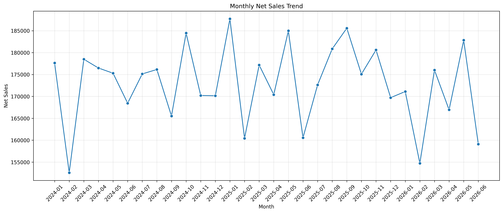                   | **02. Monthly Order Volume**<br>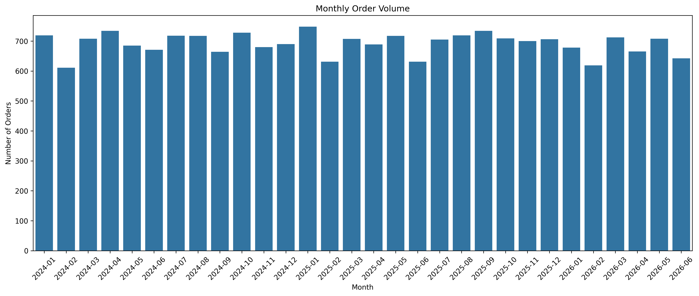                               |
| **03. Net Sales by Product Category**<br>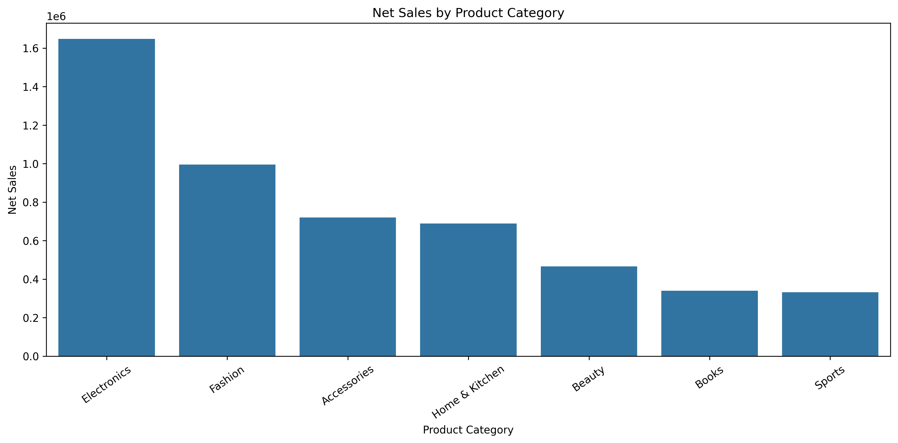            | **04. Top 10 Products by Net Sales**<br>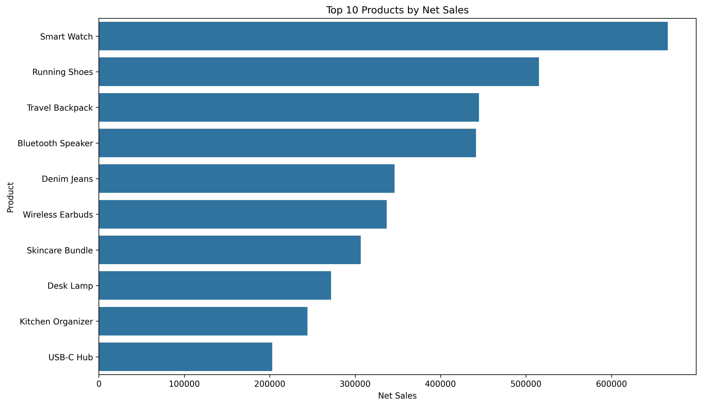       |
| **05. Top 10 Products by Units Sold**<br>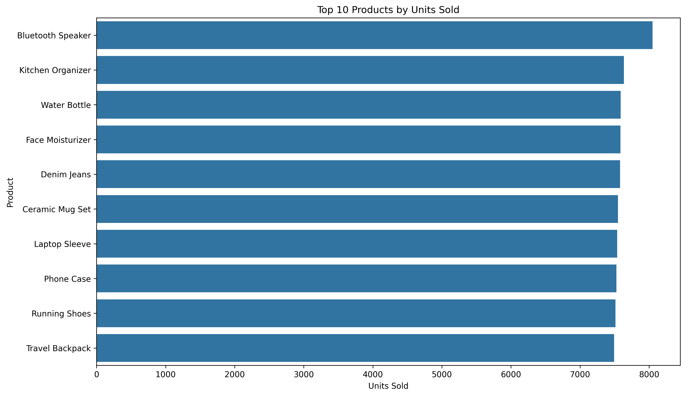 | **06. Customer Spending Distribution**<br>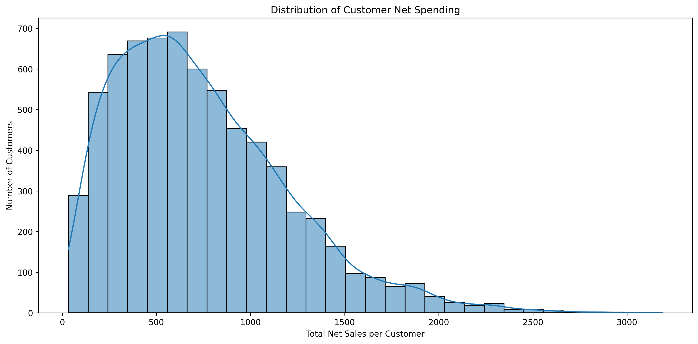 |
| **07. Top 10 Customers by Net Sales**<br>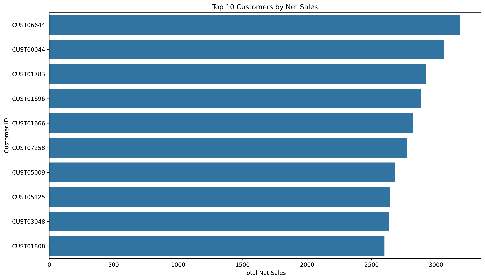 | **08. Net Sales by Region**<br>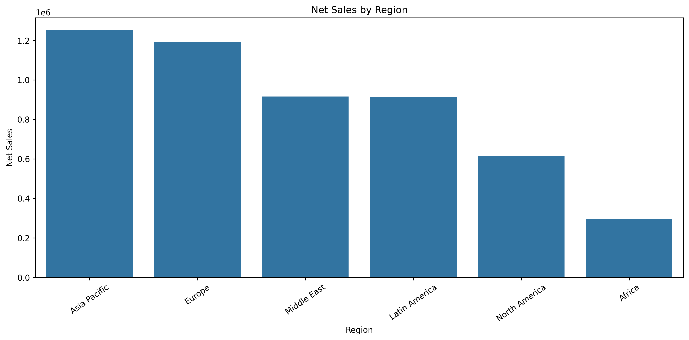                                  |
| **09. Top 10 Countries by Net Sales**<br>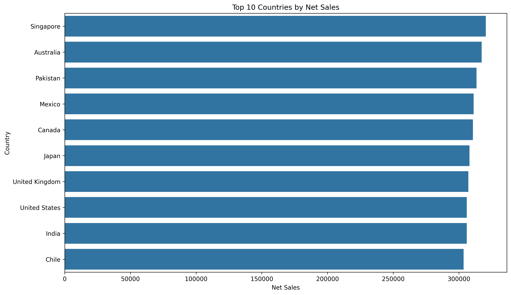 | **10. Net Sales by Payment Method**<br>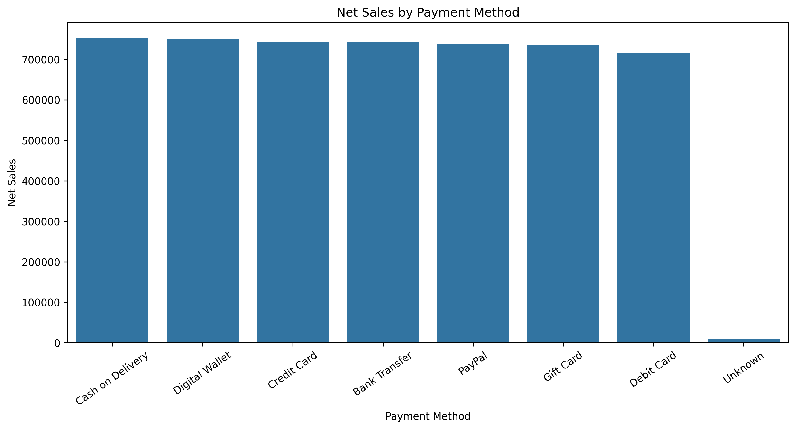          |
| **11. Return Rate by Product Category**<br>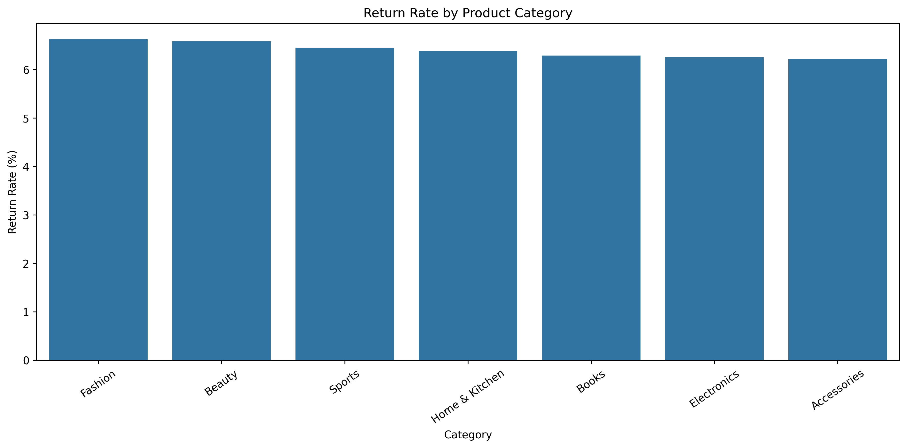   | **12. Return Rate by Country**<br>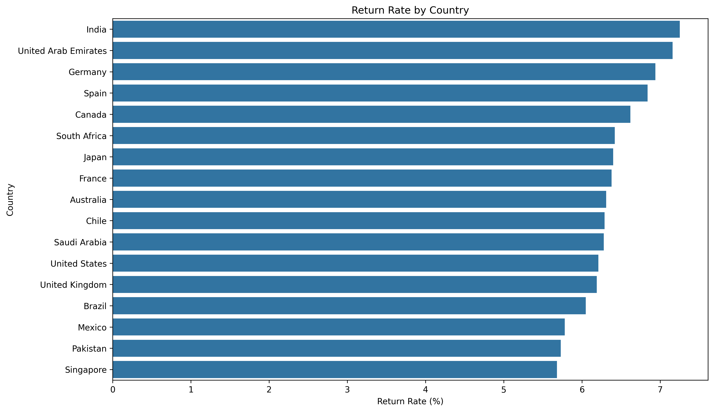                         |

### Power BI Dashboard Preview

The Power BI report contains three interactive pages. The screenshots below provide a preview of each page; the interactive report is available in `PowerBI/Ecommerce_Sales_Dashboard.pbix`.

|                           Executive Overview                           |                           Product Performance                            |                               Regional & Customer Insights                                |
| :--------------------------------------------------------------------: | :----------------------------------------------------------------------: | :---------------------------------------------------------------------------------------: |
| 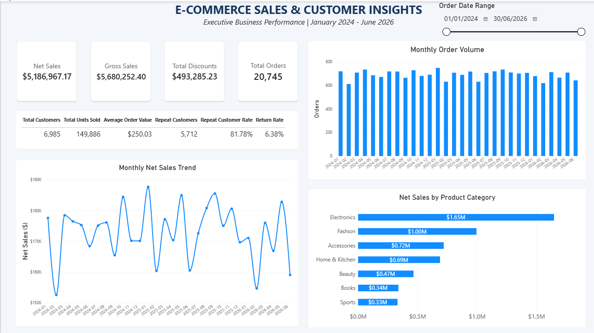 | 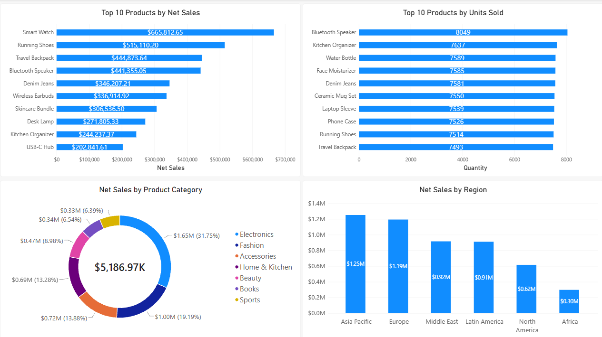 | 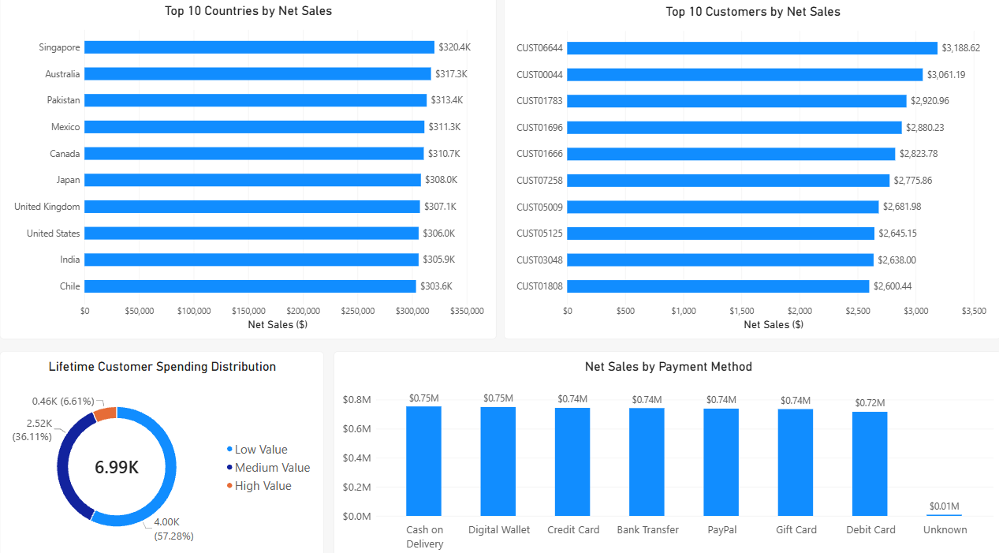 |

## Project Status

**Status:** Data loading and inspection completed; data quality assessment performed; data cleaning and exploratory data analysis completed; SQL database setup, data validation, and business analysis completed; Power BI data modelling, core DAX measures, and three-page interactive dashboard completed; final project report and README documentation completed. RFM-based customer segmentation remains pending.

The raw dataset remains unchanged. The first Python notebook covers data loading, structural inspection, and initial validation. The second notebook assesses missing values, duplicates, categorical inconsistencies, numerical validity, date logic, financial calculation consistency, and potential statistical outliers. The third notebook performs the cleaning operations, validates the resulting dataset, and exports the cleaned CSV to `Dataset/Cleaned/`. The fourth notebook analyses sales performance, products, customers, regional performance, payment-method sales attribution, and returns, and exports 12 plots to `Screenshots/Plots/`. The two SQL scripts provide conditional database and table creation, guarded CSV import, data-quality validation, financial discrepancy investigation, and business analysis across sales, products, customers, regions, payment methods, and returns. SQL execution and final reconciliation have been completed successfully. The Power BI model includes a marked date table, an active date relationship, a dedicated measures table, and 10 core DAX measures validated against the SQL results. The completed three-page dashboard includes an Executive Overview, Product Performance, and Regional & Customer Insights, with a synchronised order-date range slicer. Page screenshots are displayed above and stored in `Screenshots/Dashboard/`; the PBIX report is stored in `PowerBI/`. The final project report is saved in `Reports/`. RFM-based customer segmentation remains pending.

## Disclaimer

This project is intended for educational and portfolio purposes. Dataset characteristics, sources, and any synthetic data usage will be documented as part of the project.
